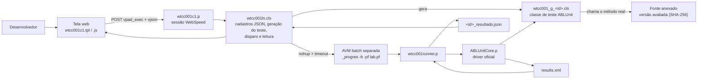
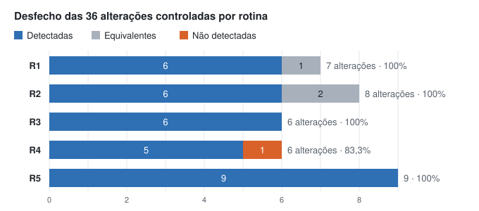

# Laboratório de regressão ABLUnit (OpenEdge 12.2)

Protótipo desenvolvido no Trabalho de Conclusão de Curso **"Automação de testes em sistemas legados desenvolvidos em Progress OpenEdge ABL: uma abordagem para identificação de falhas de regressão"** (Engenharia de Software, UniSATC, 2026).

A ferramenta permite que o desenvolvedor, por uma tela web, faça o seguinte:

1. Cadastre **baterias** e **cenários de teste**: método a chamar, argumentos e resultado esperado.
2. **Anexe** a versão do fonte que quer avaliar (por exemplo, a versão original e cada alteração controlada), identificada por SHA-256.
3. Solicite a execução: o servidor **gera uma classe de teste ABLUnit** a partir dos cenários e a executa com o driver oficial `ABLUnitCore.p`, em uma **AVM batch separada** da sessão web.
4. Consulte o resultado por caso (aprovado, falha de asserção ou inconclusivo), os logs e o tempo, e exporte um CSV.

> Este repositório contém apenas o código desenvolvido para o laboratório. Não inclui fontes, regras de negócio, configurações nem dados da empresa onde o experimento foi realizado. Os caminhos de servidor e os nomes de classe que aparecem no código são genéricos (`/opt/ablunitlab/...`, `clsexemplo`).

## Arquivos

| Arquivo | Papel |
|---|---|
| `wtcc001c1.p` | Programa WebSpeed da tela: carrega o template e atende às ações AJAX (`vpad_exec`) |
| `wtcc001c1.tpl` | Template HTML da tela |
| `wtcc001c1.js` | Interface: cadastros, anexo de fonte em partes, leitura das assinaturas públicas, execução, resultados e CSV |
| `wtcc001c1.css` | Estilos da tela |
| `wtcc001ln.cls` | Núcleo: cadastros em JSON, geração da classe de teste, disparo da AVM batch, leitura do `results.xml` e classificação dos resultados |
| `wtcc001runner.p` | Programa executado na AVM batch: valida o pedido, roda o `ABLUnitCore.p`, lê o XML e grava o resultado |
| `wtcc001.exemplo.json` | Exemplo de configuração |
| `wtcc001lab.exemplo.pf` | Modelo do arquivo de parâmetros da AVM de testes |

## Como funciona



Os valores dos cenários ficam em um snapshot JSON da rodada, e não no código gerado.

- **Fonte anexado:** durante a execução, a versão anexada é copiada para o diretório de trabalho, que fica primeiro no PROPATH da AVM de teste, e é removida ao final. Assim o código instalado nunca é alterado, e cada relatório fica associado ao SHA-256 da versão avaliada.
- **Classificação dos resultados:**
  - falha de asserção (`OpenEdge.Core.AssertionFailedError`) = **FALHA**;
  - erro de compilação, conexão ou timeout, XML ausente ou quantidade de testes divergente = **INCONCLUSIVO**;
  - nunca se aprova uma execução sem XML ou com testes ignorados.
- **Comparação:** o texto é comparado de forma exata (`COMPARE ... "RAW"` e tamanho). Números e datas são convertidos a partir do JSON, e `?` representa o valor desconhecido.
- **Concorrência:** um lock em arquivo permite uma execução por vez, e os cadastros têm controle de revisão.

## Resultados obtidos no experimento do TCC

A ferramenta foi usada para avaliar **5 rotinas** de **2 classes** de um sistema legado em ABL, com **74 casos de teste** e **36 alterações controladas** (mutações manuais), uma por execução. Os nomes reais das classes e rotinas foram omitidos.



| Rotina | Tipo de regra | Casos | Alterações | Detectadas | Equivalentes | Não detectadas | Taxa de detecção* |
|---|---|---|---|---|---|---|---|
| R1 | Normalização de chave | 9 | 7 | 6 | 1 | 0 | 100% |
| R2 | Decisão por tipo de tabela | 7 | 8 | 6 | 2 | 0 | 100% |
| R3 | Conversão de código (tabela completa) | 23 | 6 | 6 | 0 | 0 | 100% |
| R4 | Classificação por amostra de cada classe | 17 | 6 | 5 | 0 | 1 | 83,3% |
| R5 | Divisão protegida e precedência de operadores | 18 | 9 | 9 | 0 | 0 | 100% |
| **Total** | | **74** | **36** | **32** | **3** | **1** | **97,0%** |

\* Taxa = detectadas / (detectadas + não detectadas), excluindo as equivalentes. Sobre o total de 36 alterações, a proporção é de 88,9%.

O que os resultados mostram:

- **Classificação correta das execuções:** nenhuma alteração foi inválida e nenhuma execução da série foi inconclusiva. Problemas de ambiente encontrados na preparação, como nome de arquivo diferente da classe e esquema de banco incompatível, foram classificados como inconclusivos e não contaram como detecção.
- **A abrangência dos casos importa mais que a quantidade:** a única alteração não detectada removeu uma linha de uma tabela de decisão que não tinha caso de teste (R4). Em R3, onde todas as entradas da tabela foram testadas, todas as alterações foram detectadas.
- **Casos de limite e alternativos:** 11 das 32 detecções dependeram exclusivamente deles.
- **Tempo:** entre 0,36 s e 0,59 s de testes por execução, concentrado no primeiro caso (carga da classe avaliada).

Exemplo de falha de asserção registrada pela ferramenta, numa alteração que trocou `/` por `*` em uma divisão:

```
Esperado: [5] / Obtido: [20]. is not true
```

Os resultados valem para a amostra avaliada e não representam a eficácia geral do ABLUnit. As limitações estão discutidas no TCC.

## Requisitos

- OpenEdge **12.2** (desenvolvido e usado na 12.2.16) em Linux, com `OS-COMMAND` permitido no agente e `nohup`, `timeout`, `/bin/sh`, `ln`, `date`, `mv`, `cat` e `rm` disponíveis.
- **ABLUnit** no PROPATH da AVM de testes (`ablunit.pl` e `OpenEdge.Core.pl` do `$DLC`). A biblioteca da Progress **não** é distribuída aqui.
- A tela depende do framework web do sistema hospedeiro, que **não faz parte deste repositório**:
  - os includes `webpro.i` e `wpadfunc.i`;
  - a classe `Template`;
  - as variáveis de sessão `semp-empresa`, `suni-unidade` e `vusu-usuario`;
  - o script `wtpl_funcs.js` e os recursos em `/sistema/...`.

  Para usar em outro ambiente, adapte essas dependências.

## Configuração

1. Ajuste os caminhos fixos no código para o seu servidor:
   - `/opt/ablunitlab/app`: fontes e configuração;
   - `/opt/ablunitlab/trabalho`: cadastros, XML e logs;
   - `/opt/ablunitlab/templates`: template da tela.

   Os pontos a alterar estão em `wtcc001c1.p`, `wtcc001ln.cls`, `wtcc001runner.p` e em mensagens do `wtcc001c1.js`.
2. Copie `wtcc001.exemplo.json` para `wtcc001.json` e ajuste `dlc`, `avm`, `laboratory_pf`, `framework_propath`, `allowed_business_classes` e `allowed_test_classes`. Mantenha `execution_enabled` como `false` até configurar o `.pf`.
3. Copie `wtcc001lab.exemplo.pf` para o seu `.pf` de laboratório, com as conexões dos **bancos de teste**. Nunca use bancos de produção, porque os métodos chamados são executados de verdade.
4. Compile `wtcc001ln.cls`, `wtcc001runner.p` e `wtcc001c1.p` na mesma versão do OpenEdge da AVM de testes e publique a tela pelo mecanismo do sistema hospedeiro.

Os fontes ABL, o TPL e o JS estão em **ISO-8859-1** com quebras de linha CRLF. O `.gitattributes` evita conversões automáticas.

## Cuidados

- O modelo "Chamar método" executa o método real nos bancos do `.pf`. Use apenas métodos sem efeito colateral, ou bancos de laboratório descartáveis.
- A validação da requisição na tela é simples (marcador no POST). Não exponha a tela fora de uma rede interna sem reforçar a autenticação e a verificação de origem.

## Licença

Nenhuma licença foi definida até o momento. Todos os direitos são reservados ao autor.
